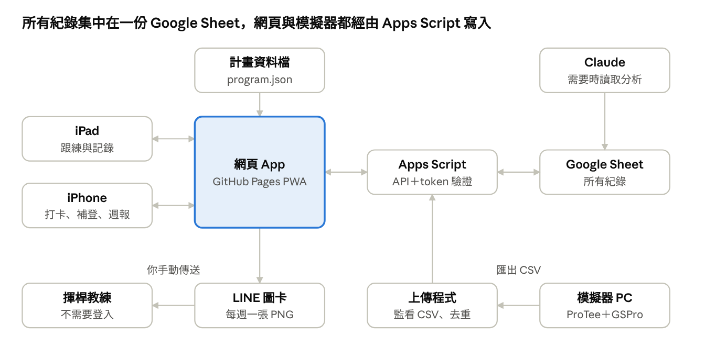
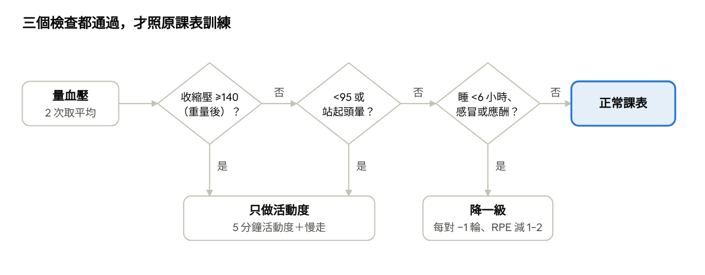

# 高爾夫體能訓練網頁 App 規格書

Oct 20, 2026 · @LUMINGCHUAN

## 一、範圍

這個網頁把[高爾夫球體適能訓練計畫書](https://claude.ai/code/artifact/14f34d82-869e-4baa-91ff-cc5266652e5c)變成每天可以照著做的工具：告訴你今天該做什麼、帶你一個動作一個動作跟練、記錄結果，並依計畫書的規則調整下一次的內容。計畫書是規則的唯一來源；網頁只執行規則，不另外發明規則。

**使用者與裝置**

| 使用者    | 裝置                       | 用來做什麼                                                                     |
|-----------|----------------------------|--------------------------------------------------------------------------------|
| 你        | iPad（橫向，放在訓練區旁） | 跟練：看影片、計時、記錄每組                                                   |
| 你        | iPhone                     | 跟練（出差或沒帶 iPad 時）、訓練前檢查、每日活動度打卡、下場後補登成績、看週報 |
| 模擬器 PC | Windows 上的小程式         | 把擊球數據上傳到資料庫                                                         |
| 揮桿教練  | LINE                       | 收每週一張狀態圖卡，不需要登入網頁                                             |
| Claude    | 讀取資料庫                 | 需要時分析趨勢、協助調整計畫                                                   |

**這一版要做**：今日待辦、訓練前檢查、跟練模式、訓練與疼痛記錄、自動調整建議、測試與複測、模擬器數據與下場成績、趨勢圖、教練週報圖卡、醫療紀錄、16
週日曆。

**這一版不做**：推播通知、寫入行事曆、帳號系統、多使用者、自動讀取 Apple
Watch（列為第二版）、自動判斷動作對不對（影像辨識）。提醒只在打開網頁時以「今日待辦」顯示。

## 二、系統架構

沿用先前已確定的做法：網頁放在 GitHub Pages，做成 PWA 加到 iPad 和
iPhone 主畫面；資料存在 Google Sheet，由 Google Apps Script 當
API。計畫內容（課表、規則、影片連結）放在 repo 裡的
program.json，和紀錄分開。

系統架構 · 網頁、API、資料庫、模擬器上傳、教練圖卡

網頁和模擬器都不直接碰資料庫，一律經過 Apps Script 驗證 token
後才寫入；教練只收圖卡，不接觸系統。

| 元件       | 技術                                                                               | 費用 |
|------------|------------------------------------------------------------------------------------|------|
| 網頁 App   | 單一 index.html＋幾個 JS 檔，無建置步驟；manifest＋service worker；圖表用 Chart.js | 免費 |
| 部署       | GitHub Pages（免費方案 repo 需設為 public，程式碼公開；個人資料不放在 repo）       | 免費 |
| API        | Google Apps Script Web App（doGet／doPost）                                        | 免費 |
| 資料庫     | Google Sheet，一份檔案、多個分頁                                                   | 免費 |
| 模擬器上傳 | Windows 上的 Python 程式，開機自動執行                                             | 免費 |

## 三、畫面與功能

網頁底部固定 5
個分頁：今日、紀錄、數據、教練、更多。打開網頁第一眼就是「今日」，一個大按鈕就能開始當天的訓練。

| 分頁 | 畫面       | 內容與操作                                                                                                                                                                                                                                                              |
|------|------------|-------------------------------------------------------------------------------------------------------------------------------------------------------------------------------------------------------------------------------------------------------------------------|
| 今日 | 今日待辦   | 第幾週、哪一期、今天的課表或休息日；每日活動度打卡；本週進度（訓練 2/3 次、活動度 5/7 天）；複測週、下場週、回診問題未完成時的提醒；器材添購提醒（依計畫書第十四節：8–10kg 壺鈴第 4 週、軟式藥球第 10 週前、16kg 依第 12 週複測結果；買好後在設定裡勾選）；出差模式切換 |
| 今日 | 訓練前檢查 | 輸入 2 次血壓（自動取平均）、睡眠時數、身體狀況（感冒、應酬隔天、疼痛部位與分數）；依第五節規則決定今天是正常課表、降一級，或只做活動度                                                                                                                                 |
| 今日 | 跟練模式   | 見第四節                                                                                                                                                                                                                                                                |
| 今日 | 訓練結束   | 輸入 Apple Watch 的平均、最高心率和總時間；整體 RPE；不適部位；備註                                                                                                                                                                                                     |
| 紀錄 | 訓練紀錄   | 依日期列出每次訓練，可以點進去看每組的實際次數、重量、RPE；可以修改或補登                                                                                                                                                                                               |
| 紀錄 | 疼痛紀錄   | 下背（坐姿穿襪）分數的趨勢，以及其他部位的出現次數                                                                                                                                                                                                                      |
| 紀錄 | 16 週日曆  | 每一天的課表類型和完成狀態；標出複測週、下場日、春節                                                                                                                                                                                                                    |
| 數據 | 測試與複測 | 第 0、4、8、12、16 週的記錄表，欄位照計畫書第四節；自動和第 0 週比較，用箭頭顯示進步或退步                                                                                                                                                                              |
| 數據 | 擊球數據   | 從模擬器上傳的資料，依日期和球桿篩選；每次練習的平均值、離散度、甜蜜點比例；速度區塊的桿頭速度單獨顯示                                                                                                                                                                  |
| 數據 | 下場成績   | 總桿數、前後九、上球道率、GIR、推桿數、後半場體力、隔天痠痛                                                                                                                                                                                                             |
| 數據 | 趨勢圖     | 桿頭速度、carry 標準差、甜蜜點比例、胸椎旋轉、toe touch、下背痛、完成率、體重；圖上標出期別和下場日                                                                                                                                                                     |
| 教練 | 本週圖卡   | 產生計畫書第十二節格式的圖卡，存成圖片後由你用 LINE 傳給教練                                                                                                                                                                                                            |
| 教練 | 教練回饋   | 記錄教練的建議；標記「需要修改課表」時，提醒你和 Claude 一起改 program.json                                                                                                                                                                                             |
| 更多 | 醫療紀錄   | 計畫書第十三節的回診問題清單（可勾選、填答案）、ECG 錄製紀錄、病史摘要                                                                                                                                                                                                  |
| 更多 | 動作庫     | 所有動作的影片、要點、退階與進階版，可以搜尋                                                                                                                                                                                                                            |
| 更多 | 設定       | Apps Script 網址與 token、器材清單（目前有的壺鈴重量）、字級、資料匯出（CSV／JSON）                                                                                                                                                                                     |

## 四、跟練模式

跟練模式是這個網頁最重要的畫面，iPad 和 iPhone 都要能完整跟練：iPad
橫放時左邊播影片、右邊顯示這一組要做什麼；iPhone
直拿時影片在上、操作在下。流程、紀錄和規則完全相同，整個過程手不必碰螢幕太多次。

**畫面配置（iPad 橫向）**

- 左半邊：目前動作的示範影片（YouTube
  內嵌，預設靜音、循環播放）。第一次做的動作，影片會先完整播一次才能開始。

- 右半邊上方：動作名稱、第幾對第幾輪（例如「A1／第 2 輪 共 3
  輪」）、目標次數或秒數、重量。

- 右半邊中間：一行要點，加上固定的呼吸提醒，例如「起身時吐氣」。

- 右半邊下方：大按鈕「完成這組」，RPE 0–10
  的快速選擇，以及「動作走樣」勾選。

- 角落：「不舒服」按鈕，按下後立刻暫停並顯示第二節的停止規則。

**畫面配置（iPhone 直向）**

- 上方約 40%：示範影片，可以點一下放大成全螢幕。

- 中間：動作名稱、第幾對第幾輪、目標次數或秒數（大字），下面一行要點與呼吸提醒。

- 下方：「完成這組」大按鈕、RPE 0–10 快速選擇、「動作走樣」勾選。

- 角落：「不舒服」按鈕。

- iPhone 橫放時自動切換成和 iPad 相同的左右版面。

- 手機放在地上或靠牆時也能看清楚：目標次數至少
  40pt，倒數計時和語音提示與 iPad 相同。

**一次訓練的流程**

1.  從「今日」按「開始訓練」，先完成訓練前檢查（血壓、睡眠、狀況）。

2.  熱身：依序播放 5
    個活動度動作，每個動作倒數計時，結束自動跳到下一個。

3.  主訓練：依課表的成對順序進行。做完 A1 按「完成這組」→ 自動切到 A2 →
    做完 A2 後開始組間休息倒數。

4.  組間休息畫面：倒數秒數、下一個動作的預覽影片，以及「輸入目前心率」欄位（看
    Apple Watch 後輸入，可略過）。輸入的心率 \>120 時，倒數改成「休息到
    100 以下」，並提醒手錶讀數和自覺費力差很多時以 RPE 為準。

5.  每組預設帶入計畫的次數和重量；實際做的不一樣時，在「完成這組」前用
    ＋／− 修改。

6.  爆發力動作（第三期）第一組前先帶一組 50%
    力量的暖身組，並額外顯示「速度一掉就停」，並在每組後問「這組速度有沒有掉？」。

7.  收操：依序播放收操動作，最後 1 分鐘慢走倒數，並提醒「起身前先坐 3
    秒」。

8.  結束：輸入 Apple Watch 的平均、最高心率和總時間，填整體 RPE
    和不適部位，存檔後顯示下一次課表的調整建議。

**中斷與恢復**：中途關掉網頁或螢幕鎖定，下次打開會問「要從 B1 第 2
輪繼續嗎？」。每完成一組就先存在 iPad 上，不會因為斷線遺失。

**螢幕不關閉**：跟練中使用瀏覽器的 Screen Wake Lock，避免 iPad
自動鎖定；不支援時提示你把自動鎖定改長。

**語音提示（可關）**：倒數最後 3
秒和換動作時，用瀏覽器內建語音念出「下一個：A2 斜板伏地挺身」。

## 五、規則引擎

網頁依計畫書的規則自動算出「今天做什麼」和「下一次怎麼調」。規則的數字（血壓門檻、心率上限、進入條件）都寫在
program.json，不寫死在程式裡；計畫書修改時，只要更新這個檔案。調整一律是「建議」，要你在訓練結束畫面按確認才生效。

**1. 日期 → 課表**

- 第 0 週是 10/22–10/25；第 1 週從 2026/10/26（一）起算，每 7 天一週，第
  16 週結束於 2027/2/14。

- 週次對應期別：第 1–4 週第一期、第 5–9 週第二期、第 10–14 週第三期、第
  15–16 週第四期。

- 訓練日彈性：網頁不綁定星期幾，而是依順序建議「下一份是 A、B 或
  C」；距離上一次訓練不到 1
  天時提醒休息。預設週行程（計畫書第一節）只用來顯示建議日。

- 已知日期寫在 program.json：複測週（第 0、4、8、12、16
  週）、下場日（12/27、1/23）和減量表、春節
  2/4–2/10。日期落在減量表內時，以減量表取代一般課表。

- 出差模式：開啟後把當期動作換成計畫書第十節的徒手替代動作，組數和 RPE
  不變。

**2. 訓練前檢查**

訓練前檢查 · 3 個判斷、3 種結果

第一次量到 ≥140 時，網頁先計時 5 分鐘、請你重量一次，重量後仍 ≥140
才處理成「只做活動度」。血壓、睡眠和狀況都會存進紀錄，可以給醫師看趨勢。

**3. 訓練中的安全規則**

| 觸發條件               | 網頁的反應                                                            |
|------------------------|-----------------------------------------------------------------------|
| 組間輸入心率 \>120     | 倒數改成「休息到 100 以下」，並記下這次超過                           |
| 按「不舒服」           | 暫停計時，全螢幕顯示計畫書第二節的停止規則與 119 提示；記錄症狀與時間 |
| 某動作記錄下背痛 ≥4/10 | 當次就改成退階版；連續兩次就建議移除，並列入教練圖卡                  |
| 心率讀數和 RPE 差很多  | 可以勾「手錶讀數可疑」，該組以 RPE 判斷                               |

**4. 進度調整（計畫書第十一節）**

每次訓練結束後，對每個動作判斷一次：

| 判斷依據                                                                                                                                                       | 建議                                                                          |
|----------------------------------------------------------------------------------------------------------------------------------------------------------------|-------------------------------------------------------------------------------|
| 各組都達標、未勾動作走樣、RPE 比目標低 1 以上                                                                                                                  | 次數升級：每組 +2 下（每期上限 12–15 下）                                     |
| 加重或進階版：肌力動作看「連續 2 次課都多做 2 下、RPE 不高於目標」；爆發力動作看「連續 2 次不痛、穩定、RPE ≤6、速度沒變慢」；計時動作看「連續 2 次多撐 10 秒」 | 升一級：加重（壺鈴依設定裡有的重量，最多 +2–4kg，次數回到範圍下限）或換進階版 |
| RPE ≥8，或勾了動作走樣                                                                                                                                         | 降一級：每對 −1 輪、目標 RPE 減 1–2，或換退階版                               |
| 擺盪連續 2 次課在 5 下內超過 120                                                                                                                               | 建議改成壺鈴硬舉或橋式                                                        |
| 一週完成不到 2 次；連續 2 週不到 2 次                                                                                                                          | 不升級；改成 A＋C 精簡版                                                      |

限制：同一個動作每週只改一個變項，網頁額外建議的升級每週最多 2
個動作（課表排定的進度和換期不算在內）；超過時只保留優先度最高的兩個（hinge、旋轉類優先）。

**5. 12kg 進入條件（計畫書第七節）**

網頁在「今日」顯示「進入條件 2/3」這類進度，三項都達到才把硬舉、深蹲換成
12kg、加入壺鈴擺盪（擺盪先用
8–10kg）；還沒達到時，依設定裡有的壺鈴自動帶入
8–10kg，擺盪顯示為壺鈴硬舉。

| 條件                                  | 資料來源                             |
|---------------------------------------|--------------------------------------|
| 坐姿穿襪下背痛 ≤1/10，連續 2 週       | 每週日的活動度打卡時填一次 0–10 分數 |
| 球桿 hip hinge 2 × 10 三點不離桿      | 該動作的紀錄：達標且未勾動作走樣     |
| 6kg 羅馬尼亞硬舉 3 × 12，RPE ≤5、不痛 | 該動作的紀錄：次數、RPE、疼痛        |

## 六、資料結構

資料分成兩部分：**計畫**（program.json，放在
repo，不含個人資料）和**紀錄**（Google Sheet，一份檔案、10
個分頁）。每筆紀錄都有
id（UUID，由產生的那一端建立，用來去重）、created_at、updated_at、source（web／simulator／manual）。

**Google Sheet 分頁**

| 分頁        | 一列代表           | 主要欄位                                                                                                                                                                                                                            |
|-------------|--------------------|-------------------------------------------------------------------------------------------------------------------------------------------------------------------------------------------------------------------------------------|
| Sessions    | 一次訓練           | date、week、phase、session_type（A／B／C／長課／減量／出差）、status（完成／部分／只做活動度）、bp_sys_1、bp_dia_1、bp_sys_2、bp_dia_2、sleep_h、condition、hr_avg、hr_max、duration_min、rpe_session、pain_area、pain_score、notes |
| SetLogs     | 一組動作           | session_id、exercise_id、pair（A1…）、round、target_reps、reps、load_kg、rpe、form_breakdown（動作走樣）、pain_score、hr_rest、hr_suspect（手錶讀數可疑）                                                                           |
| Mobility    | 一次每日活動度     | date、done、sock_pain（坐姿穿襪下背 0–10）                                                                                                                                                                                          |
| Tests       | 一次複測的一個項目 | date、week、test_id、side（左／右／無）、value、unit、note                                                                                                                                                                          |
| Shots       | 一顆球             | datetime、club、ball_speed、club_speed、smash、carry、total、back_spin、side_spin、offline、hla、vla、peak_height、aoa、block（一般／速度區塊）、file_name                                                                          |
| Rounds      | 一場下場           | date、course、score、front9、back9、fairways、gir、putts、late_energy（0–10）、next_day_pain                                                                                                                                        |
| Body        | 一次量測           | date、weight_kg、waist_cm、resting_hr                                                                                                                                                                                               |
| CoachNotes  | 一則教練回饋       | date、content、needs_program_change、done                                                                                                                                                                                           |
| Medical     | 一個回診問題或事件 | date、type（問題／ECG／症狀）、content、answer、file_link                                                                                                                                                                           |
| Suggestions | 一則調整建議       | date、exercise_id、change（+2 下、+1 輪、加重、降級…）、reason、accepted                                                                                                                                                            |

**program.json 結構**

{  
"version": "2026-10-20",  
"start_date": "2026-10-26",  
"safety": { "bp_sys_max": 140, "bp_sys_min": 95, "hr_max": 120,
"hr_resume": 100, "rpe_cap": 7, "sleep_min_h": 6 },  
"phases": \[ { "id": 1, "weeks": \[1, 4\], "rpe": \[4, 5\], "rest_s":
\[30, 45\] } \],  
"special_dates": { "retest_weeks": \[0, 4, 8, 12, 16\], "rounds":
\["2026-12-27", "2027-01-23"\], "holiday": \["2027-02-04",
"2027-02-10"\] },  
"taper": \[ { "date": "2026-12-23", "plan": "mobility_walk" } \],  
"sessions": { "P1-A": \[ { "pair": "A1", "exercise": "dowel_hinge",
"reps": 10, "rounds": 2 } \] },  
"exercises": { "dowel_hinge": { "name": "球桿 hip hinge", "cue":
"三點不離桿", "breath": "起身時吐氣", "video":
"https://www.youtube.com/watch?v=PG67O49Hsso", "regress": "...",
"progress": "...", "travel_sub": "..." } },  
"gates": { "kb12": \[ "sock_pain\<=1 for 14d", "dowel_hinge 2x10 clean",
"rdl_6kg 3x12 rpe\<=5 no_pain" \] }  
}

上面只列結構和一兩個範例；完整內容在開發時從計畫書逐項轉入，並由一支檢查程式比對計畫書和
program.json 的課表是否一致。

## 七、外部資料整合

第一版用已確認可行的方法：模擬器靠 CSV 匯出加自動上傳，Apple Watch
心率手動輸入。即時自動讀取列為第二版，因為要先驗證 ProTee 和 GSPro
之間的連線方式。

**模擬器擊球數據**

| 版本   | 做法                                                                                                                                                                                                  | 你要做的事                     | 狀態                                              |
|--------|-------------------------------------------------------------------------------------------------------------------------------------------------------------------------------------------------------|--------------------------------|---------------------------------------------------|
| 第一版 | 練習結束按 GSPro 畫面上的「Export CSV to Desktop」；模擬器 PC 上的上傳程式監看桌面，發現新 CSV 就解析、去重、上傳                                                                                     | 打之前選對球桿；打完按一次匯出 | 已確認有匯出按鈕                                  |
| 第二版 | 上傳程式在 ProTee 和 GSPro 之間轉送 [GSPro Open Connect](https://gsprogolf.com/GSProConnectV1.html) 的資料（本機 127.0.0.1、port 921），同時把每一球記下來；可以和燈光自動化的 Shot-State Bridge 共用 | 不用做任何事                   | 待驗證 ProTee VX 是否透過 Open Connect 傳給 GSPro |

上傳程式的要求：

- **去重**：每一球用「時間＋球速＋carry＋back spin」產生雜湊值，同一個
  CSV 重複匯出不會重複寫入。

- **球桿標記**：以 CSV 裡的球桿欄位為準。速度區塊要用 GSPro
  另外開一個練習回合、打完單獨匯出一次，網頁上可以把整個檔案標成「速度區塊」。

- **桿頭速度與 smash factor**：先確認 CSV
  有沒有桿頭速度。上次截圖的畫面沒有顯示這一欄；如果 CSV
  也沒有，就要等第二版從 Open Connect 的 ClubData 取得，或改從 ProTee
  自己的軟體匯出。

- **斷線重試與紀錄檔**：沒有網路時先存在本機，恢復後自動補傳；每次上傳寫一行
  log。

- **安裝**：Windows 開機自動執行（工作排程器），附安裝說明。

**Apple Watch 心率**

| 版本   | 做法                                                                                                                 |
|--------|----------------------------------------------------------------------------------------------------------------------|
| 第一版 | 訓練時用 Apple Watch 開「傳統肌力訓練」；組間看手錶輸入目前心率（可略過）；結束時在網頁輸入平均、最高心率和總時間    |
| 第二版 | 用 iPhone「捷徑」讀取健康 App 裡該次體能訓練的心率樣本，自動傳到 Apps Script。開發前先確認捷徑能讀到每分鐘的心率資料 |

**Claude 讀取資料**：Google Sheet 分享給你自己的 Google
帳號即可；之後要分析時，在對話裡連接 Google Drive，Claude 就能讀取同一份
Sheet。

## 八、離線、同步與資料安全

原則是：訓練中絕不因為網路斷線而卡住，個人健康資料只放在你自己的 Google
帳號裡。

**離線與同步**

- 網頁本體和 program.json 由 service worker
  快取，沒有網路也能開啟、跟練、記錄。

- 每完成一組就先寫進 iPad
  本機（IndexedDB）的待上傳佇列；有網路時自動上傳，畫面角落顯示「尚有 N
  筆未同步」。

- 示範影片是
  YouTube，無法離線播放；沒有網路時改顯示文字要點和退階、進階版。

- iPad 和 iPhone 各自寫入；同一筆紀錄被兩邊修改時，以 updated_at
  較新的為準。打開網頁時會從 Sheet 拉最新資料。

**API 與驗證**

- Apps Script 部署成 Web App，任何人都能連到網址，所以每次請求都要帶一組
  token；token 只在「設定」輸入一次，存在裝置上，不放進程式碼或 repo。

- POST 請求使用 Content-Type: text/plain，避免瀏覽器跨網域的 CORS
  預檢失敗。

- 模擬器上傳程式使用另一組 token，只能寫入 Shots 分頁；token
  外洩時可以單獨換掉。

**個人資料**

- GitHub repo 是公開的（免費方案的 GitHub Pages 需要公開），所以 repo
  裡只放程式碼和不含個人資訊的 program.json；病史、血壓、用藥一律只存在
  Google Sheet。

- Google Sheet 不公開分享。

- 「設定」提供一鍵匯出全部資料（CSV 與 JSON）；建議每月匯出一次備份。

## 九、介面與非功能需求

| 項目       | 要求                                                                                                           |
|------------|----------------------------------------------------------------------------------------------------------------|
| 語言       | 繁體中文介面，動作名稱保留英文（例如 Pallof press）                                                            |
| 主要裝置   | iPad 橫向與 iPhone 直向都能完整跟練；iPhone 另外負責打卡、補登、週報；用 Safari 測試，加到主畫面後以全螢幕開啟 |
| 字級與按鈕 | 跟練畫面的目標次數至少 48pt，站在 2 公尺外看得清楚；主要按鈕至少 60 × 60pt，流汗的手也按得準                   |
| 顏色       | 晚上 8 點使用，預設深色模式；安全提醒用紅色，降級建議用橘色                                                    |
| 速度       | 打開到顯示「今日」不超過 2 秒（有快取時）；按「完成這組」後畫面立即反應，上傳在背景進行                        |
| 可靠性     | 中途關掉、斷網、螢幕鎖定都不遺失已完成的組數                                                                   |
| 圖卡       | 教練週報輸出成 1080 × 1350 的 PNG，手機上直接分享到 LINE                                                       |
| 隱私       | 見第八節                                                                                                       |
| 維護       | 改課表只需改 program.json；不需要改程式                                                                        |

## 十、開發階段與驗收標準

照之前的規劃用 Claude Code 開發，計畫書和這份規格書匯出成 Markdown 放在
repo 的 docs/ 資料夾，每次開工前先讀。目標是在第 1
週（10/26）前做出能跟練的最低可用版本；做出來之前，先照計畫書文件訓練、用
Apple Watch 記錄。

| 階段      | 內容                                                                                   | 驗收標準                                                                                       |
|-----------|----------------------------------------------------------------------------------------|------------------------------------------------------------------------------------------------|
| M0 準備   | 建 GitHub repo、Google Sheet 與 10 個分頁、部署 Apps Script；把計畫書轉成 program.json | 檢查程式比對計畫書與 program.json，課表、次數、影片連結全部一致                                |
| M1 能跟練 | 今日、訓練前檢查、跟練模式、訓練記錄、離線佇列、加到主畫面                             | 在 iPad 和 iPhone 各完成一次第一期課表 A；中途關閉 Wi-Fi 仍能做完，恢復後 Sheet 有每一組的紀錄 |
| M2 會調整 | 規則引擎（進度建議、12kg 進入條件、減量週、出差模式）、16 週日曆、動作庫               | 用假資料模擬 4 週訓練，網頁給的每一則建議都和計畫書第十一節的規則一致（附測試案例清單）        |
| M3 看數據 | 模擬器上傳程式第一版、擊球數據、測試與複測、下場成績、趨勢圖                           | 匯出 CSV 後 1 分鐘內出現在網頁；同一個 CSV 匯出兩次不會重複；複測自動和第 0 週比較             |
| M4 給教練 | 教練週報圖卡、教練回饋、醫療紀錄、資料匯出                                             | iPhone 上產生的圖卡可以直接分享到 LINE，數字和 Sheet 一致                                      |
| 第二版    | Open Connect 即時讀取擊球數據、捷徑自動匯入心率                                        | 先完成可行性驗證，再決定是否開發                                                               |

**每個階段完成時**：Claude Code 列出做了什麼、怎麼測的，你在 iPad
上實際操作一次確認後，才進入下一階段。

## 十一、待確認事項

開始 M0 之前需要你提供或確認以下幾項：

- [ ] GitHub 帳號，以及 repo 名稱（例如 golf-fitness）

- [ ] 用哪個 Google 帳號建立 Sheet 和 Apps Script（個人帳號或公司帳號）

- [ ] iPad 和 iPhone 的型號與 iOS
  版本（確認螢幕不關閉、語音提示等功能能用）

- [ ] 模擬器 PC 的 Windows 版本、GSPro 版本

- [ ] 匯出一份 GSPro 的 CSV 給我，確認欄位裡有沒有桿頭速度、smash factor
  和球桿名稱

- [ ] 上傳程式要開機自動執行，還是練習時手動啟動

- [ ] 你偏好讓 Claude 遠端連到模擬器 PC
  讀取資料；要不要把這個列進第二版，取代或補充 CSV 上傳
